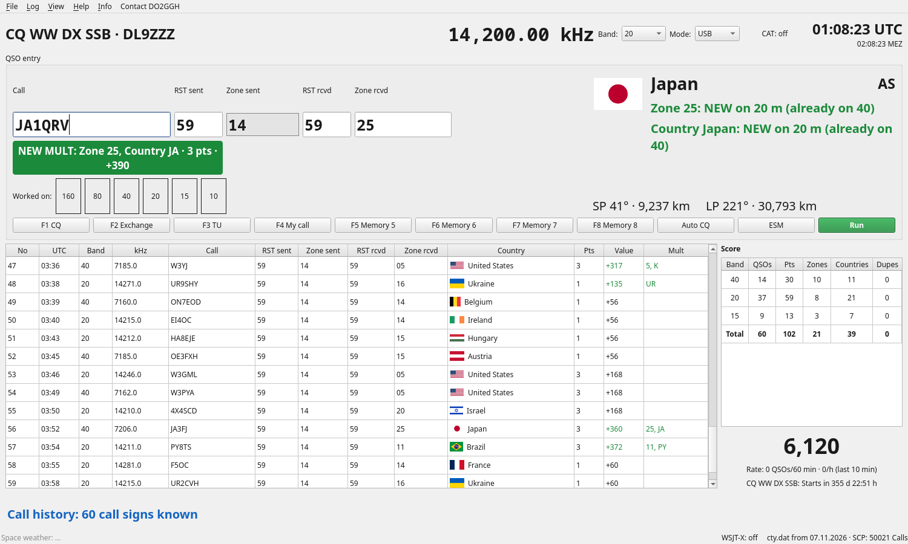

# GoGoHam – contest logger for Linux

[Deutsch](README.md) · **English**

A fast contest logger for Linux: **type the call, space, exchange, Enter – done.**
Dupes, new multipliers and the score are calculated while you type.
Free of charge, free software (GPL-3.0).



*The picture shows a practice log with invented call signs.*

## What GoGoHam does

- **Live scoring while typing:** dupe, new multipliers, QSO points and value for the total score
- **Super Check Partial** with colours, **call history that learns with every QSO**, **info box** with flag, country, multiplier
  status, short/long path and distance
- **130 HF and VHF contests** as readable rule files – own rules possible, new and changed ones come
  automatically from GitHub; contest calendar and search when creating a log
- **CAT via Hamlib** (rigctld) for many radios, with radio detection and up to five profiles,
  shareable with WS (DG2YCB); take over QSOs from WS (FT8/FT4/FT2)
- **Radios over LAN/WLAN**: Icom (IC-705, IC-7610, IC-9700 …) directly without an extra program,
  including audio over the network; other radios via Hamlib or on another computer (beta)
- **CW** via the radio or a WinKey (also microHAM DXP), CW messages and voice memories on F1–F8,
  voice keyer with your own voice
- **Auto CQ** and “Enter sends” for run and S&P
- **DX cluster with band map**, beacon display, space weather and band opening forecast
- **Grey line map** with short/long path, beacons and spots; rotator control with compass rose
- **USB GPS receiver:** just plug it in – position, locator and time, also portable without internet
- **QTC** for the WAE, **DOK checking** for DARC contests
- **Station log for multi-op:** several computers in the same network write one common log
- **Export** as Cabrillo, complete ADIF and EDI (VHF), name/QTH via HamQTH and QRZ.com, log check
  before submitting
- **Overview** of multipliers per band, rate graph, contest clock with operating time, live score to
  online scoreboards
- **Practice mode** for CW and SSB: run, S&P and mixed, with results – nothing is transmitted
- **Spoken announcements** – also for visually impaired radio amateurs
- Automatic **backups** with repair, clock check, bug report
- Configurable log columns, light and dark themes, user interface in **twenty languages** (18 of them beta), manual in German and English with search

GoGoHam is made for **one operator on one computer** (single-op).

## Contests

**HF, international:** CQ WW DX (SSB, CW) · CQ WPX (SSB, CW) · CQ WW 160 m (SSB, CW) ·
WW Digi DX (FT4/FT8) · ARRL International DX (SSB, CW) · ARRL 10 m · ARRL 160 m · Stew Perry Topband ·
IARU HF World Championship ·
EU HF Championship · WAE DX (SSB, CW, with QTC) · Russian DX · RSGB IOTA · All Asian DX (SSB, CW) ·
OK/OM DX (SSB, CW) · HA DX · UBA DX (SSB, CW) · PACC · SP DX · LZ DX · 9A DX (Croatian DX) ·
YO DX HF · S.M. El Rey de España / King of Spain (SSB, CW) · JIDX (CW, SSB) · SAC (CW, SSB) ·
RAC Canada Day · NAQP (CW, SSB, RTTY) · ARRL International Digital · BARTG HF RTTY · AOEC 160 m ·
AGCW Happy New Year

**DARC (Germany):** WAG (Worked All Germany) · DARC 10 m · Christmas contest (XMAS) · Easter contest ·
FT4 contest · CW training contest · training contest · IARU Region 1 Field Day (SSB, CW)

**More German contests:** DIG QSO Party (SSB, CW) · German Telegraphy Contest (DTC)

**VHF/UHF:** IARU Region 1 VHF (145 MHz) · IARU Region 1 UHF/microwaves · Marconi Memorial (CW) ·
DARC VHF/UHF/SHF contest · spring contest · microwave contest · winter field day · summer field day · Alpe Adria VHF

Exchange, points and multipliers of every contest are listed in the manual (*Help → Manual →
Contests and rules*). The rule files are also available on their own:
[GoGoHam-rules](https://github.com/do2ggh/GoGoHam-rules).

## Installation

### From your distribution's package repository (recommended)

This installs GoGoHam like any other program and **keeps it up to date with your normal system
update**. For trying it out, the finished packages are also available individually under
[Releases](https://github.com/do2ggh/GoGoHam/releases) – but without automatic updates.

#### openSUSE Tumbleweed / Leap 16

```bash
# Tumbleweed:
sudo zypper addrepo https://download.opensuse.org/repositories/home:/Franz/openSUSE_Tumbleweed/home:Franz.repo
# or Leap 16.0:
sudo zypper addrepo https://download.opensuse.org/repositories/home:/Franz/16.0/home:Franz.repo

sudo zypper refresh
sudo zypper install gogoham
```

#### Fedora 43 / 44

```bash
sudo curl -fsSL -o /etc/yum.repos.d/home_Franz.repo \
  https://download.opensuse.org/repositories/home:/Franz/Fedora_$(rpm -E %fedora)/home:Franz.repo
sudo dnf install gogoham
```

#### Debian 13 / Ubuntu 26.04

```bash
# Debian 13: R=Debian_13 · Ubuntu 26.04: R=xUbuntu_26.04
R=Debian_13
curl -fsSL https://download.opensuse.org/repositories/home:/Franz/$R/Release.key | gpg --dearmor | sudo tee /etc/apt/trusted.gpg.d/home_Franz.gpg > /dev/null
echo "deb https://download.opensuse.org/repositories/home:/Franz/$R/ /" | sudo tee /etc/apt/sources.list.d/home_Franz.list
sudo apt update
sudo apt install gogoham
```

#### Arch / Garuda / Manjaro

```bash
curl -fsSL https://download.opensuse.org/repositories/home:/Franz/Arch/x86_64/home_Franz_Arch.key | sudo pacman-key --add -
sudo pacman-key --lsign-key D389DED10CE918036666175678AF9B87F520FFB8
printf '\n[home_Franz_Arch]\nServer = https://download.opensuse.org/repositories/home:/Franz/Arch/$arch\n' | sudo tee -a /etc/pacman.conf
sudo pacman -Syu gogoham
```

The repository is hosted by the [openSUSE Build Service](https://build.opensuse.org/package/show/home:Franz/gogoham). The key the packages are signed with has the fingerprint `D389DED10CE918036666175678AF9B87F520FFB8`. Installation has been tested on fresh systems of all distributions listed above. For announcements (speech output) on Arch, also install `qt6-speech`. Once the repository is added, GoGoHam also shows up in the software centre (Discover, GNOME Software …) under "Ham radio".

### From source (Arch, Garuda, Manjaro)

```bash
git clone https://github.com/do2ggh/GoGoHam.git
cd GoGoHam
./install.sh
```

The script installs the required packages (PySide6, Qt Multimedia, NumPy, Hamlib) with `pacman`,
copies GoGoHam to `~/.local/share/gogoham/app` and adds an entry to the start menu. Then start
GoGoHam from the start menu or with `gogoham` in a terminal.

**Updating:** *Help → Check for a new version …* – one click fetches the new version from GitHub,
checks it and puts it in place at the restart. Only if a new version needs new system packages,
run `install.sh` from the new source again (GoGoHam tells you).

So that GoGoHam may use USB devices (radio cables, GPS receivers, WinKeyers), the script asks
whether it should allow them for you – this works right away, without logging in again. The
packages from the repository already include this.

**Uninstall:** `bash ~/.local/share/gogoham/uninstall.sh` – your logs in `~/GoGoHam` are always kept.

## First steps

1. **Start GoGoHam.** If the country file (cty.dat) is missing, GoGoHam offers to download it.
2. **Set up the radio:** *File → Settings → Radio* – GoGoHam detects many radios by itself. It also
   works without a radio: then choose band and mode by hand.
3. **New log:** *File → New contest log* (Ctrl+N), choose the contest, enter your call and exchange.
4. **Log:** type the call, space, exchange, Enter.
5. **Submit:** *Log → Export log* (Ctrl+E) creates the file for the contest organiser.

Everything else is in the **manual** (*Help → Manual*, with search). To practise without a radio
and without transmitting: *File → Practice mode*.

Your logs are stored in `~/GoGoHam/`, the settings in `~/.config/gogoham/`.

## Reporting bugs and contributing

- **Found a bug?** In the program use *Help → Create bug report …* – the report contains everything
  needed to find the problem, but no passwords and no QSOs. Then please open an **issue** here on
  GitHub and paste the report.
- **Ideas, praise and questions:** do2ggh.de@gmail.com
- **Contributing:** bug reports and ideas are very welcome. I do not accept code from others –
  details in [CONTRIBUTING.md](CONTRIBUTING.md).

What changed in each version: [CHANGELOG.md](CHANGELOG.md) (in German).

## License

GoGoHam is licensed under the **GNU General Public License, version 3 only** ([LICENSE](LICENSE)) –
this includes the logo, icons and splash screen. Two additional terms apply (preserve the author
attribution, mark modified versions): [ADDITIONAL-TERMS.md](ADDITIONAL-TERMS.md).
The contest rule files are licensed under CC BY 4.0. Third-party components and their terms:
[THIRD-PARTY.md](THIRD-PARTY.md).

© 2026 Franz, DO2GGH · do2ggh.de@gmail.com
