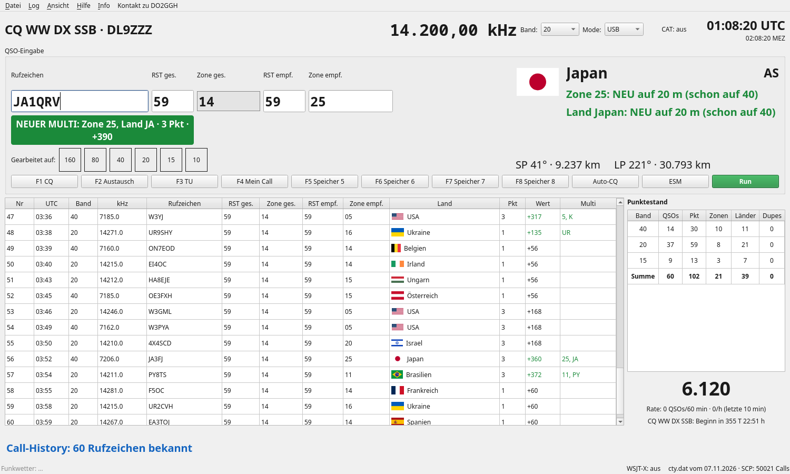

# GoGoHam – Contest-Logger für Linux

**Deutsch** · [English](README.en.md)

Schneller Contest-Logger für Linux: **Rufzeichen tippen, Leertaste, Austausch, Enter – fertig.**
Dupe-Prüfung, neue Multis und Punktestand werden schon beim Tippen berechnet.
Kostenlos, freie Software (GPL-3.0).



*Das Bild zeigt ein Übungslog mit erfundenen Rufzeichen.*

## Was GoGoHam kann

- **Live-Wertung beim Tippen:** Dupe, neue Multis, QSO-Punkte und Wert fürs Gesamtergebnis
- **Super Check Partial** mit Farben, **Call-History, die mit jedem QSO dazulernt**, **Infobox** mit Flagge, Land, Multi-Status,
  Short/Long Path und Entfernung
- **130 Contests auf Kurzwelle und UKW** als lesbare Regel-Dateien – eigene Regeln möglich, neue und
  geänderte kommen automatisch von GitHub; Contest-Kalender und Suche beim Anlegen eines Logs
- **CAT über Hamlib** (rigctld) für viele Funkgeräte, mit Geräteerkennung und bis zu fünf Profilen,
  gemeinsam mit WS (DG2YCB) nutzbar; QSOs aus WS (FT8/FT4/FT2) übernehmen
- **Funkgeräte über LAN/WLAN**: Icom (IC-705, IC-7610, IC-9700 …) direkt ohne Zusatzprogramm,
  samt Ton übers Netz; andere Geräte über Hamlib oder an einem anderen Rechner (Beta)
- **CW** über das Funkgerät oder einen WinKey (auch microHAM DXP), CW-Texte und Sprachspeicher auf
  F1–F8, Sprachausgabe mit der eigenen Stimme
- **Auto-CQ** und „Enter sendet“ für Run und S&P
- **DX-Cluster mit Bandmap**, Bakenanzeige, Funkwetter und Bandöffnungs-Vorschau
- **Grayline-Karte** mit Short/Long Path, Baken und Spots; Rotorsteuerung mit Kompassrose
- **GPS-Empfänger per USB:** einstecken genügt – Standort, Locator und Uhrzeit, auch portabel ohne
  Internet
- **QTC** für den WAE, **DOK-Prüfung** für DARC-Contests
- **Stationslog für Multi-OP:** mehrere Rechner im selben Netzwerk schreiben ein gemeinsames Log
- **Export** als Cabrillo, vollständiges ADIF und EDI (UKW), Name/QTH über HamQTH und QRZ.com,
  Log-Prüfung vor dem Einreichen
- **Übersicht** der Multis je Band, Rate-Grafik, Contest-Uhr mit Betriebszeit, Live-Score an
  Online-Scoreboards
- **Übungsmodus** für CW und SSB: Run, S&P und gemischt, mit Auswertung – es wird nichts gesendet
- **Ansagen per Sprachausgabe** – auch für sehbehinderte Funkamateure
- Automatische **Sicherungen** mit Reparatur, Uhrzeit-Prüfung, Fehlerbericht
- Einstellbare Log-Spalten, Designs hell und dunkel, Oberfläche in **zwanzig Sprachen** (18 davon Beta), Handbuch auf Deutsch und Englisch mit Suche

GoGoHam ist für **einen Operator an einem Rechner** gedacht (Single-OP).

## Contests

**Kurzwelle, international:** CQ WW DX (SSB, CW) · CQ WPX (SSB, CW) · CQ WW 160 m (SSB, CW) ·
WW Digi DX (FT4/FT8) · ARRL International DX (SSB, CW) · ARRL 10 m · ARRL 160 m · Stew Perry Topband ·
IARU HF World Championship ·
EU HF Championship · WAE DX (SSB, CW, mit QTC) · Russian DX · RSGB IOTA · All Asian DX (SSB, CW) ·
OK/OM DX (SSB, CW) · HA DX · UBA DX (SSB, CW) · PACC · SP DX · LZ DX · 9A DX (Croatian DX) ·
YO DX HF · S.M. El Rey de España / King of Spain (SSB, CW) · JIDX (CW, SSB) · SAC (CW, SSB) ·
RAC Canada Day · NAQP (CW, SSB, RTTY) · ARRL International Digital · BARTG HF RTTY · AOEC 160 m ·
AGCW Happy New Year

**DARC:** WAG (Worked All Germany) · DARC 10 m · Weihnachtswettbewerb (XMAS) · Ostercontest ·
FT4 Contest · CW-Ausbildungscontest · Ausbildungscontest · IARU Region 1 Fieldday (SSB, CW)

**Weitere deutsche Contests:** DIG-QSO-Party (SSB, CW) · Deutscher Telegrafie Contest (DTC)

**UKW:** IARU Region 1 VHF (145 MHz) · IARU Region 1 UHF/Mikrowellen · Marconi Memorial (CW) ·
DARC VHF-/UHF-/SHF-Wettbewerb · UKW-Frühlingswettbewerb · Mikrowellen-Wettbewerb ·
UKW-Winter-Fieldday · UKW-Sommer-Fieldday · Alpe Adria VHF

Austausch, Punkte und Multis jedes Contests stehen im Handbuch (*Hilfe → Handbuch → Contests und
Regeln*). Die Regel-Dateien gibt es auch einzeln: [GoGoHam-rules](https://github.com/do2ggh/GoGoHam-rules).

## Installation

### Über die Paketquelle deiner Distribution (empfohlen)

So wird GoGoHam wie jedes andere Programm installiert und **mit dem normalen Systemupdate
aktuell gehalten**. Nur zum Ausprobieren gibt es die fertigen Pakete auch einzeln unter
[Releases](https://github.com/do2ggh/GoGoHam/releases/latest) – dann aber ohne automatische Updates.

#### openSUSE Tumbleweed / Leap 16

```bash
# Tumbleweed:
sudo zypper addrepo https://download.opensuse.org/repositories/home:/Franz/openSUSE_Tumbleweed/home:Franz.repo
# oder Leap 16.0:
sudo zypper addrepo https://download.opensuse.org/repositories/home:/Franz/16.0/home:Franz.repo

sudo zypper refresh
sudo zypper install gogoham
```

#### Fedora 43 / 44

```bash
sudo curl -fsSL -o /etc/yum.repos.d/home_Franz.repo \
  https://download.opensuse.org/repositories/home:/Franz/Fedora_$(rpm -E %fedora)/home:Franz.repo
sudo dnf install gogoham
```

#### Debian 13 / Ubuntu 26.04

```bash
# Debian 13: R=Debian_13 · Ubuntu 26.04: R=xUbuntu_26.04
R=Debian_13
curl -fsSL https://download.opensuse.org/repositories/home:/Franz/$R/Release.key | gpg --dearmor | sudo tee /etc/apt/trusted.gpg.d/home_Franz.gpg > /dev/null
echo "deb https://download.opensuse.org/repositories/home:/Franz/$R/ /" | sudo tee /etc/apt/sources.list.d/home_Franz.list
sudo apt update
sudo apt install gogoham
```

#### Arch / Garuda / Manjaro

```bash
curl -fsSL https://download.opensuse.org/repositories/home:/Franz/Arch/x86_64/home_Franz_Arch.key | sudo pacman-key --add -
sudo pacman-key --lsign-key D389DED10CE918036666175678AF9B87F520FFB8
printf '\n[home_Franz_Arch]\nServer = https://download.opensuse.org/repositories/home:/Franz/Arch/$arch\n' | sudo tee -a /etc/pacman.conf
sudo pacman -Syu gogoham
```

Die Paketquelle liegt beim [openSUSE Build Service](https://build.opensuse.org/package/show/home:Franz/gogoham). Der Schlüssel, mit dem die Pakete unterschrieben sind, hat den Fingerabdruck `D389DED10CE918036666175678AF9B87F520FFB8`. Getestet ist die Installation auf frischen Systemen aller oben genannten Distributionen. Für die Ansagen (Sprachausgabe) unter Arch zusätzlich `qt6-speech` installieren. Ist die Paketquelle eingetragen, findest du GoGoHam auch in der Software-Verwaltung (Discover, GNOME Software …) unter „Amateurfunk“.

### Als Live-Stick (ohne Installation)

GoGoHam läuft auch direkt von einem USB-Stick (ab 16 GB) – an jedem Rechner, ohne etwas zu
installieren; Logs und Einstellungen bleiben auf dem Stick. Das Abbild
`gogoham-live-<Version>.iso` gibt es unter [Releases](https://github.com/do2ggh/GoGoHam/releases/latest).
Auf den Stick schreiben mit balenaEtcher, `dd` oder Rufus (**DD-Modus**) – Anleitung in der
beiliegenden `LIESMICH.txt` und im Handbuch, Kapitel „Live-Stick“.

### Aus dem Quelltext (Arch, Garuda, Manjaro)

```bash
git clone https://github.com/do2ggh/GoGoHam.git
cd GoGoHam
./install.sh
```

Das Skript installiert die nötigen Pakete (PySide6, Qt-Multimedia, NumPy, Hamlib) mit `pacman`,
kopiert GoGoHam nach `~/.local/share/gogoham/app` und legt einen Eintrag im Startmenü an. Danach
startest du GoGoHam über das Startmenü oder im Terminal mit `gogoham`.

**Aktualisieren:** *Hilfe → Nach neuer Version suchen …* – ein Klick holt die neue Version von
GitHub, prüft sie und spielt sie beim Neustart ein. Nur wenn eine neue Version neue Systempakete
braucht, `install.sh` aus dem neuen Quelltext noch einmal ausführen (GoGoHam sagt es dann).

Damit GoGoHam USB-Geräte (Funkgerät-Kabel, GPS-Empfänger, WinKeyer) benutzen darf, fragt das
Skript, ob es sie für dich freigeben soll – das gilt sofort, ohne neu anmelden. Die Pakete aus der
Paketquelle bringen diese Freigabe schon mit.

**Deinstallieren:** `bash ~/.local/share/gogoham/uninstall.sh` – deine Logs in `~/GoGoHam` bleiben immer erhalten.

## Erste Schritte

1. **GoGoHam starten.** Fehlt die Länderdatei (cty.dat), bietet GoGoHam den Download an.
2. **Funkgerät einrichten:** *Datei → Einstellungen → Funkgerät* – GoGoHam erkennt viele Geräte
   selbst. Ohne Funkgerät geht es auch: Band und Mode dann von Hand wählen.
3. **Neues Log:** *Datei → Neues Contest-Log* (Strg+N), Contest wählen, Rufzeichen und Austausch
   eintragen.
4. **Loggen:** Rufzeichen tippen, Leertaste, Austausch, Enter.
5. **Einreichen:** *Log → Log exportieren* (Strg+E) erzeugt die Datei für den Veranstalter.

Alles Weitere steht im **Handbuch** (*Hilfe → Handbuch*, mit Suche). Üben ohne Funkgerät und ohne
zu senden: *Datei → Übungsmodus*.

Deine Logs liegen in `~/GoGoHam/`, die Einstellungen in `~/.config/gogoham/`.

## Fehler melden und mitmachen

- **Fehler gefunden?** Im Programm *Hilfe → Fehlerbericht erstellen …* – der Bericht enthält alles,
  was für die Suche wichtig ist, aber keine Passwörter und keine QSOs. Dann bitte hier auf GitHub
  unter **Issues** einen Fehlerbericht anlegen und den Bericht einfügen.
- **Ideen, Lob und Fragen:** do2ggh.de@gmail.com
- **Mitmachen:** Fehlerberichte und Ideen sind sehr willkommen. Fremden Programmcode nehme ich
  nicht an – Einzelheiten in [CONTRIBUTING.md](CONTRIBUTING.md).

Was sich in jeder Version geändert hat: [CHANGELOG.md](CHANGELOG.md).

## Lizenz

GoGoHam steht unter der **GNU General Public License, nur Version 3** ([LICENSE](LICENSE)) – das
gilt auch für Logo, Symbole und Ladebildschirm. Dazu kommen zwei Zusatzbedingungen
(Urhebervermerk erhalten, veränderte Fassungen kennzeichnen): [ADDITIONAL-TERMS.md](ADDITIONAL-TERMS.md).
Die Contest-Regel-Dateien stehen unter CC BY 4.0. Fremde Teile und ihre Bedingungen:
[THIRD-PARTY.md](THIRD-PARTY.md).

© 2026 Franz, DO2GGH · do2ggh.de@gmail.com
